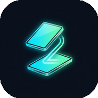

# TwoUI — Galaxy Z Flip 4 Cover Launcher

<p align="center">
  
  <br>
</p>

---

## 📌 Tentang Proyek Ini

**TwoUI** adalah proyek *fork* dan pengembangan lebih lanjut dari **SamSprung TooUI**. Proyek ini difokuskan secara khusus untuk memaksimalkan potensi layar luar (*cover screen*) pada **Samsung Galaxy Z Flip 4** (resolusi 512×260), menghadirkan pengalaman multitasking penuh tanpa perlu membuka ponsel lipat Anda.

Dengan TwoUI, layar luar Galaxy Z Flip 4 dapat menjalankan aplikasi Android apa saja (seperti WhatsApp, YouTube, Chrome, Instagram), mengetik pesan suara secara langsung, menyesuaikan kerapatan DPI layar agar elemen antarmuka tidak terpotong, mengganti gaya jam dan wallpaper proporsional, serta mengelola konsumsi daya dengan sistem waktu mati layar (*timeout*) otomatis.

---

## 📋 Persyaratan & Izin Sistem

Aplikasi ini memerlukan beberapa izin Android agar dapat mengontrol antarmuka layar cover secara maksimal:

1. **Accessibility Service**:
   Diperlukan untuk menjalankan perintah *Back*, *Lock Screen* (screen timeout & double-tap lock), dan integrasi dikte suara.
2. **Display Over Other Apps**:
   Diperlukan agar peluncur dan navigasi TwoUI dapat muncul di layar luar.
3. **Akses Notifikasi**:
   Diperlukan untuk menampilkan daftar notifikasi masuk pada halaman cover.
4. **Izin Pengaturan Sistem Aman (WRITE_SECURE_SETTINGS - Opsional via ADB)**:
   Diperlukan jika ingin mengubah DPI layar cover secara langsung dari menu pengaturan:
   ```bash
   adb shell pm grant com.yopa.samsprung android.permission.WRITE_SECURE_SETTINGS
   ```

---


## 📄 Hak Cipta & Lisensi

Proyek ini didistribusikan di bawah lisensi Apache License 2.0.

```text
Copyright (C) 2022 SamSprung
Copyright (C) 2026 yopaaa
```

Lihat berkas [LICENSE](LICENSE) untuk ketentuan lisensi selengkapnya.
